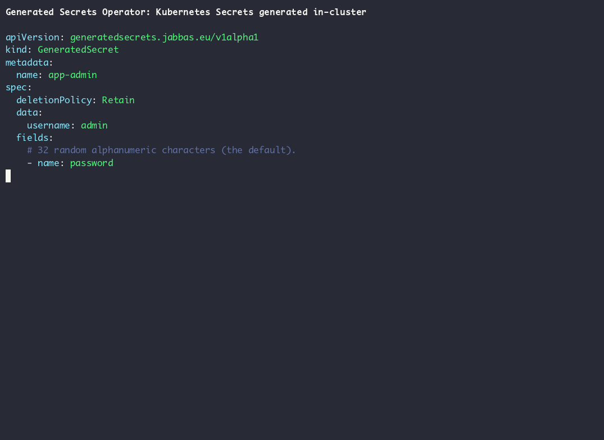

# Generated Secrets Operator

[](https://github.com/jabbas/generated-secrets-operator/releases/latest)
[](https://github.com/jabbas/generated-secrets-operator/actions/workflows/ci.yml)
[](LICENSE)

**Generate Kubernetes Secrets in-cluster: passwords, tokens, SSH keys.
Declared next to your app; the values are never stored in Git.**

Website: https://generatedsecrets.jabbas.eu

[](https://asciinema.org/a/x5iEg5qgU8xqvcfN)

Write a `GeneratedSecret` next to your application; the operator creates the
`Secret` once and then leaves its values alone:

```yaml
apiVersion: generatedsecrets.jabbas.eu/v1alpha1
kind: GeneratedSecret
metadata:
  name: app-admin            # the Secret gets the same name and namespace
spec:
  fields:
    - name: password         # 32 random alphanumeric characters by default
```

## Why

- Helm's `randAlphaNum` with `lookup` generates a new value under Argo CD and
  `helm template`, because `lookup` returns nothing there.
- Encrypting a password with SOPS (Secrets OPerationS) or Sealed Secrets adds
  key management when no human needs to know the password.
- A pipeline that exists only to generate a key is a pipeline to maintain.

The one promise: **a value changes only when you decide** — you change its
definition, delete the Secret (or one key), or configure a rotation. It does
not change when the operator restarts or is upgraded, when its cache is lost,
or when you re-apply the same manifest.

## Try it in 5 minutes

You need `kind`, Helm 4 and `kubectl`; no clone is needed. The `kind` image
below runs Kubernetes 1.34, the oldest supported version.

```sh
kind create cluster --image kindest/node:v1.34.11@sha256:44e222ee2132dab25ff87301682f89eb82c7880ea3a1bf543bfe9708fd08d67d
helm repo add jabbas https://jabbas.github.io/helm-charts
helm repo update jabbas
helm install generated-secrets-operator jabbas/generated-secrets-operator --version 0.2.0 --namespace generated-secrets-system --create-namespace --wait
kubectl apply -f - <<'EOF'
apiVersion: generatedsecrets.jabbas.eu/v1alpha1
kind: GeneratedSecret
metadata:
  name: app-admin
spec:
  deletionPolicy: Retain
  data:
    username: admin
  fields:
    - name: password
EOF
kubectl wait --for=condition=Ready gensecret/app-admin --timeout=60s
kubectl get secret app-admin -o jsonpath='{.data.password}' | base64 -d; echo
```

Restart the operator and read the password again; it stays the same:

```sh
kubectl rollout restart deployment/generated-secrets-operator -n generated-secrets-system
kubectl rollout status deployment/generated-secrets-operator -n generated-secrets-system
kubectl get secret app-admin -o jsonpath='{.data.password}' | base64 -d; echo
```

Clean up:

```sh
kind delete cluster
```

The HTTP chart repository is not signed; for the cosign-signed chart and how to
verify it, see [Installation](docs/installation.md).

## When to use it, and when not

This operator is for secrets a machine can invent: passwords, tokens, random
keys, SSH key pairs, basic-auth credentials. Other tools fit other jobs:

| Tool | Notes |
|---|---|
| [Sealed Secrets](https://github.com/bitnami-labs/sealed-secrets), [SOPS](https://github.com/getsops/sops) | Encrypt values a human already has, to commit them to Git. Right for externally issued secrets; for machine-invented ones they add key management for no benefit. |
| [External Secrets Operator](https://external-secrets.io) | Syncs secrets from an external store (for example AWS Secrets Manager); right when that store is the source of truth. Its [generators](https://external-secrets.io/latest/guides/generator/) say "Every invocation produces a new set of values"; stable values need [three settings per object](https://external-secrets.io/latest/api/externalsecret/) (`refreshPolicy: CreatedOnce`, `target.immutable: true`, `creationPolicy: Orphan`), and by default it runs [three components](https://external-secrets.io/latest/api/components/) (controller, webhook, certificate controller). Here stable values are the default, and `deletionPolicy: Retain` lets a re-created `GeneratedSecret` adopt its Secret. |
| [HashiCorp Vault](https://www.vaultproject.io), [OpenBao](https://openbao.org) | A full secrets platform; heavy if you need only a few generated passwords. |
| Helm `randAlphaNum` + `lookup` | [`lookup` returns nothing during `helm template` and client dry-run](https://helm.sh/docs/chart_template_guide/functions_and_pipelines/), and [Argo CD does not support it](https://github.com/argoproj/argo-cd/issues/5202), so the value is regenerated. |
| [mittwald/kubernetes-secret-generator](https://github.com/mittwald/kubernetes-secret-generator) | The best-known earlier generator: annotation-driven, on plain Secrets. Latest release v3.4.1 (August 2025); the one before is from April 2022. |
| [Carvel secretgen-controller](https://github.com/carvel-dev/secretgen-controller) | Maintained, with a broader scope (secret export and import across namespaces, certificates); suits Carvel users. |

**When not to use Generated Secrets Operator:**

- The secret is issued by someone else (a vendor API key, another team's
  password).
- The value must be known before deployment, or be identical across clusters.
- The values must survive losing the cluster. They live only in the cluster
  (in etcd, the Kubernetes data store); back up the Secrets, for example with
  [Velero](https://velero.io).

Generated values are ordinary Secrets: readable with `get secrets`, and
unencrypted in etcd unless encryption at rest is enabled (see
[Security](docs/security.md)). They come from the operating system's
cryptographically secure random number generator.

## Features

- **Safe by default.** Values are generated once and stay stable; see the
  [behaviour table](docs/api-reference.md#behaviour-table).
- **Three kinds of secret**, one per `GeneratedSecret`: `fields` (random
  strings, tokens and encoded random bytes), `sshKeyPair` (ed25519, RSA or
  ECDSA) and `basicAuth` (username, password and a bcrypt `htpasswd` line).
- **Per-key control.** Length, character set, excluded characters, minimum
  counts per character class, prefix and suffix; or N random bytes in hex,
  base64, base64url or base32.
- **Optional scheduled rotation** (`rotation.interval`); manual rotation by
  deleting the Secret.
- **`deletionPolicy`:** `Delete` (default, garbage-collected with the
  `GeneratedSecret`) or `Retain` (the Secret survives; a re-created
  `GeneratedSecret` adopts it and keeps its values).
- **Mistakes surface where you look.** A bad manifest is rejected at
  `kubectl apply` / `helm install` time by the CRD (custom resource definition)
  schema and CEL (Common Expression Language) rules; runtime problems appear in
  `status.conditions` and Events.
- **Least privilege.** No `delete` on Secrets, only metadata of managed Secrets
  is cached, values never reach logs, Events, status or metrics, and the
  operator never touches a Secret it did not create. Cluster-wide or
  per-namespace RBAC (role-based access control; a real boundary).
- **Production packaging.** Multi-arch image (`linux/amd64`, `linux/arm64`),
  Helm chart (also published as an OCI (Open Container Initiative) artifact),
  leader election for high availability, Prometheus metrics, Pod Security
  `restricted`; signed releases, see [Status](#status).

## Status

The API is `generatedsecrets.jabbas.eu/v1alpha1`. Defaults and the fingerprint
format are frozen for this version, so upgrades never rotate your credentials.
Breaking changes before `v1beta1` are possible but are always called out in the
[changelog](CHANGELOG.md). Releases are cosign-signed and carry an SBOM
(software bill of materials). Every release is promoted from a release
candidate that passed a test on a real cluster (0.2.0:
[report](docs/releases/0.2.0-home-lab-test.md)). Supported Kubernetes: 1.34
and newer.

The project was renamed from SecretSpec Operator in 0.2.0, a breaking change;
see [Moving from 0.1.x](CHANGELOG.md#moving-from-01x) and
[ADR (architecture decision record) 0006](docs/adr/0006-rename-to-generated-secrets-operator.md).

## Roadmap

- [Templates and derived keys](https://github.com/jabbas/generated-secrets-operator/issues/27)
- [Namespace scoping by label selector](https://github.com/jabbas/generated-secrets-operator/issues/28)
- [Additional generators](https://github.com/jabbas/generated-secrets-operator/issues/29)
- [The `v1beta1` API](https://github.com/jabbas/generated-secrets-operator/issues/30)

New here? Issues labelled
[`good first issue`](https://github.com/jabbas/generated-secrets-operator/labels/good%20first%20issue)
are a good place to start.

## Documentation

| Document | Content |
|---|---|
| [Installation](docs/installation.md) | Install, upgrade, uninstall, values, scope modes, mirrors, CRD lifecycle, signature verification |
| [API reference](docs/api-reference.md) | Every field, default and validation; the generated Secret; behaviour table |
| [Operations](docs/operations.md) | Rotation, reloading consumers, `deletionPolicy`, troubleshooting, metrics, logging |
| [Security](docs/security.md) | Threat model, RBAC, redaction guarantees, release signing and SBOM |
| [Examples](examples/README.md) | Seven copy-paste `GeneratedSecret`s |
| [Fingerprint format](docs/fingerprints.md) | The frozen format that decides when a value is regenerated |
| [Development](docs/development.md) | Building, testing and running the operator locally |
| [Contributing](CONTRIBUTING.md) | What is welcome, what will not be accepted, how to send a change |
| [Security policy](SECURITY.md) | How to report a vulnerability privately; supported versions |

## Contributing

Bug reports, fixes, features and documentation improvements are welcome. Read
[CONTRIBUTING.md](CONTRIBUTING.md) first; for a new feature, open an issue with
the YAML you would like to write before you write code.

## Licence

Apache-2.0; see [LICENSE](LICENSE) and [NOTICE](NOTICE).

## Acknowledgement

Generated Secrets Operator was inspired by
[mittwald/kubernetes-secret-generator](https://github.com/mittwald/kubernetes-secret-generator).
